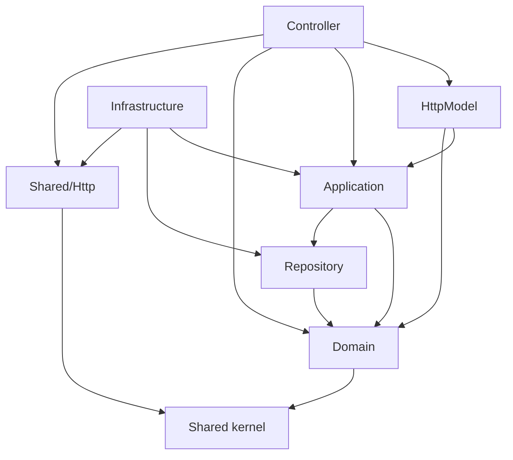

# Backend

The backend is a PHP 8.5 JSON API without a framework. Its code is organized by business
feature, each feature uses the same layers, and Deptrac checks in CI that the layers depend
on each other only in the allowed direction. A small dependency injection container, a router,
and a messaging setup are discovered from attributes in the code, so nothing is registered by
hand.

## Features and layers

[`backend/src`](../../backend/src) has one directory per feature: `Analytics`, `Auth`,
`Cart`, `Catalog`, `Order`, `Payment`, and `Report`, plus `Shared` for code several features
use.
Inside a feature, each directory is a layer:

| Layer | Directories | Holds |
|---|---|---|
| Controller | `Controller/` | `#[Route]` methods that turn an HTTP request into one application call and its result into a response |
| HttpModel | `Request/`, `Response/` | Parsing and validation of request data, and response bodies |
| Application | `Service/`, `Command/`, `Query/` | Use cases with typed arguments; they know nothing about HTTP |
| Domain | `Entity/`, `ValueObject/`, `ReadModel/`, `Enum/`, `Exception/`, `Message/`, `Gateway/` | Business rules, read models, domain exceptions, messages, and ports to external systems |
| Repository | `Repository/` | SQL and mapping of rows to objects |
| Infrastructure | `Infrastructure/` | Adapters to the outside world: mail, the session, the cache, payment gateways |

The arrows are the allowed dependencies from [`backend/deptrac.yaml`](../../backend/deptrac.yaml);
every layer may also use the shared kernel. `bin/ci` fails on any other dependency, so for
example an application service cannot reach for the HTTP session: it depends on a port such
as [`CurrentUserInterface`](../../backend/src/Auth/Service/CurrentUserInterface.php), which
the session adapter in `Auth/Infrastructure` implements.

`Order` and `Payment` split writes from reads (CQRS): `Command/` handlers change state through
entities and repositories, while `Query/` handlers return read models that the API serializes
directly, such as [`OrderView`](../../backend/src/Order/ReadModel/OrderView.php).

## Dependency injection

[`ContainerFactory`](../../backend/src/Shared/DependencyInjection/ContainerFactory.php)
builds a PSR-11 [`Container`](../../backend/src/Shared/DependencyInjection/Container.php)
from definitions that [`ServiceDiscovery`](../../backend/src/Shared/DependencyInjection/ServiceDiscovery.php)
derives from the source code:

- A class is built by resolving its constructor parameters recursively, once per container.
- An interface with exactly one implementation is bound to it; when several exist,
  `#[DefaultImplementation]` chooses one, as for the cached product repository.
- `#[ServiceFactory]` marks static methods that build services needing custom construction,
  such as the PDO connection or the logger.
- `#[Env('NAME')]` injects an environment variable into a constructor parameter, and
  `#[Autowire(Class::class)]` picks a specific implementation.

Discovery reflects every class, so
[`ServiceDiscoveryCache`](../../backend/src/Shared/DependencyInjection/ServiceDiscoveryCache.php)
stores its result in a PHP file that OPcache keeps in memory and rebuilds it when any source
file changes. `php bin/container-debug.php` lists the bindings.

Configuration comes only from environment variables, read through
[`Environment`](../../backend/src/Shared/Config/Environment.php) or `#[Env]`; a missing
variable stops the application with a clear error instead of falling back to a default.
Local values live in [`docker/env/`](../../docker/env).

## HTTP

[`HttpApplication`](../../backend/src/Shared/Http/HttpApplication.php) registers every
controller that [`ControllerDiscovery`](../../backend/src/Shared/Http/ControllerDiscovery.php)
finds in `src/*/Controller` and passes each request through middleware that every request
shares and then to the [`Router`](../../backend/src/Shared/Http/Router.php). The router builds
each route's own middleware from attributes on the controller method:

| Attribute | Effect |
|---|---|
| `#[Route(method, path)]` | Registers the method; paths may have constrained parameters such as `{id:\d+}` |
| `#[UsesSession]` | Starts the session and requires the CSRF token in `X-CSRF-Token` for state changes |
| `#[RequireMerchant]` | Implies the session; anonymous requests get 401, accounts without merchant access 403 |
| `#[RequireApiKey('VARIABLE')]` | Requires `X-Api-Key` to match the secret in the variable |
| `#[RateLimit('VARIABLE')]` | Limits requests per client address with the policy in the variable, answering 429 |
| `#[MapException(Exception::class, status)]` | Answers a domain exception with RFC 9457 problem details and the status |

Controllers are resolved from the container only when their route matches, so a request
builds no other controller and opens no connections it does not need. The order of the
middleware is described in [Request lifecycle](request-lifecycle.md).

## Persistence

Repositories use PDO with native prepared statements. Query results are hydrated by
[`RecordFetcher`](../../backend/src/Shared/Database/RecordFetcher.php) into readonly
`#[HydratedRecord]` classes whose properties match the selected column aliases, and records
that represent entities convert themselves with `toEntity()`, so no associative row arrays
travel between methods.
[`PdoTransactionRunner`](../../backend/src/Shared/Database/PdoTransactionRunner.php) runs a
callback in a transaction with an explicit isolation level. The schema changes only through
Phinx migrations in [`backend/database/migrations`](../../backend/database/migrations), which
the `migrate` container applies before the PHP services start.

Money is handled with moneyphp in minor units. Carts, orders, and payments are identified by
random UUIDs, which reveal neither how many exist nor in which order they were created;
products keep numeric ids, which the catalog exposes anyway.

## Messaging

A class marked `#[Message(transport: 'emails')]` is routed to that RabbitMQ transport, and a
method marked `#[AsMessageHandler]` handles its parameter's message type;
[`MessagingDiscovery`](../../backend/src/Shared/Messaging/MessagingDiscovery.php) finds both.
Application code never publishes directly. It adds messages to the
[outbox](../../backend/src/Shared/Messaging/Outbox/PdoOutbox.php) in the same transaction as
its data, and [`OutboxRelay`](../../backend/src/Shared/Messaging/Outbox/OutboxRelay.php),
run by [`bin/outbox-relay.php`](../../backend/bin/outbox-relay.php), publishes them, delaying
messages that are due later. [`bin/worker.php`](../../backend/bin/worker.php) consumes them.
Delivery is at least once, so handlers are idempotent.

| Message | Transport | Handler does |
|---|---|---|
| `ConfirmationEmailMessage` | `emails` | Sends the email confirmation link |
| `AccountExistsEmailMessage` | `emails` | Tells the owner of an address that someone tried to register it again |
| `ExpireOrderReservationCommand` | `orders` | Expires an unpaid order and releases its stock |
| `ProductStockChangedMessage` | `catalog` | Removes changed products from the cache |

## Logging

Monolog writes JSON lines to standard error. Every record carries the request id that
[`RequestIdMiddleware`](../../backend/src/Shared/Http/Middleware/RequestIdMiddleware.php)
assigns, the outbox stores it with each message, and the worker restores it, so one id finds
a request and the work it caused.

## Entry points

| File | Runs |
|---|---|
| [`public/index.php`](../../backend/public/index.php) | Every HTTP request, through PHP-FPM |
| [`bin/worker.php`](../../backend/bin/worker.php) | The message consumer |
| [`bin/outbox-relay.php`](../../backend/bin/outbox-relay.php) | The outbox publisher; it exits after a number of polls and is restarted, which bounds its memory |
| [`bin/create-merchant.php`](../../backend/bin/create-merchant.php), [`bin/grant-merchant.php`](../../backend/bin/grant-merchant.php) | Account administration |
| [`bin/purge-unconfirmed-accounts.php`](../../backend/bin/purge-unconfirmed-accounts.php) | Nightly cleanup |
| [`bin/retry-failed-messages.php`](../../backend/bin/retry-failed-messages.php) | Requeues messages parked in the failure queue |
| [`bin/container-debug.php`](../../backend/bin/container-debug.php) | Lists the container's bindings |

## Limitations

- The rate limiter connects to Redis on every request, even when the matched route has no
  limit.
- Deptrac checks dependencies between the project's own layers only; dependencies on library
  classes, such as PDO, moneyphp, or Symfony components, are outside its rules.
