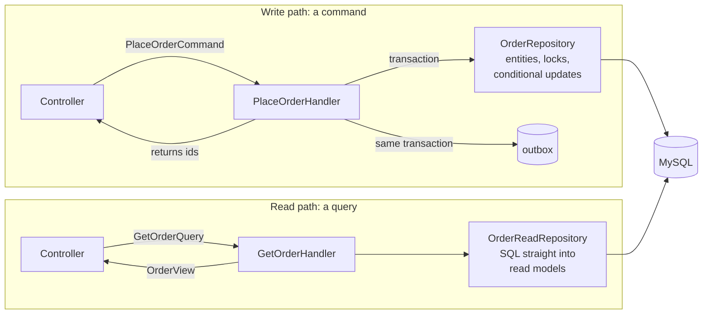

# CQRS: separate paths for changing and reading orders and payments

Command query responsibility segregation (CQRS) means that code changing state and code
reading it take different paths, with different models. The project uses it in two features,
[`Order`](../../backend/src/Order) and [`Payment`](../../backend/src/Payment), and on purpose
nowhere else ([0022](../decisions/0022-cqrs-only-for-orders-and-payments.md)).

## The two paths

| | Write path | Read path |
|---|---|---|
| Input | A command in `Command/`, such as [`PlaceOrderCommand`](../../backend/src/Order/Command/PlaceOrderCommand.php) | A query in `Query/`, such as [`GetOrderQuery`](../../backend/src/Order/Query/GetOrderQuery.php) |
| Handler | [`PlaceOrderHandler`](../../backend/src/Order/Command/PlaceOrderHandler.php), [`CancelOrderHandler`](../../backend/src/Order/Command/CancelOrderHandler.php), [`StartPaymentHandler`](../../backend/src/Payment/Command/StartPaymentHandler.php), [`HandlePaymentWebhookHandler`](../../backend/src/Payment/Command/HandlePaymentWebhookHandler.php) | [`GetOrderHandler`](../../backend/src/Order/Query/GetOrderHandler.php), [`ListOrdersHandler`](../../backend/src/Order/Query/ListOrdersHandler.php), [`GetPaymentHandler`](../../backend/src/Payment/Query/GetPaymentHandler.php) |
| Model | Entities that enforce rules, such as [`Order`](../../backend/src/Order/Entity/Order.php) and `OrderState` with its version | Read models shaped for the response, such as [`OrderView`](../../backend/src/Order/ReadModel/OrderView.php) and [`OrderSummaryPage`](../../backend/src/Order/ReadModel/OrderSummaryPage.php) |
| Repository | [`OrderRepositoryInterface`](../../backend/src/Order/Repository/OrderRepositoryInterface.php): locks, conditional updates, inserts | [`OrderReadRepositoryInterface`](../../backend/src/Order/Repository/OrderReadRepositoryInterface.php): `SELECT`s only |
| Transaction | Always, with an explicit isolation level, retried after a deadlock | None; one consistent read |
| Returns | An identifier or an outcome (the new order's id and access token, a payment id, a webhook's `processed` or `duplicate`), never a read model | A read model the API serializes as is |

A controller is the only place both meet: checkout runs `PlaceOrderHandler`, which returns the
new order's id and access token, then `GetOrderHandler` to answer with the order as any later
read would see it.

## Why the paths differ

The write path protects invariants under concurrency. Placing an order locks the cart and the
products in a fixed order, reserves stock with conditional updates, records the order and an
outbox message in one transaction, and accepts a repeated `Idempotency-Key`
([checkout flow](../flows/checkout.md)). That code needs entities, versions, and locks, and it
should not be shaped by what a page wants to show.

The read path only shapes data. An order page needs the order with its lines and totals; the
panel's list needs a page of summaries with a cursor. Reading them through entities would load
rules and state that a read never uses, so read repositories map SQL straight into read
models, and their queries can be tuned for the screen, for example with
[cursor pagination](../flows/panel.md#orders).

## Commands that arrive later

Some commands are not sent by a controller but delivered by the worker:
[`ExpireOrderReservationCommand`](../../backend/src/Order/Command/ExpireOrderReservationCommand.php)
is recorded in the outbox at checkout and handled by
[`ExpireOrderReservationHandler`](../../backend/src/Order/Command/ExpireOrderReservationHandler.php)
when the reservation ends. The same rules apply: a transaction, a conditional update on the
order's version, and no harm when the message is delivered twice
([messaging](backend.md#messaging)).

## What CQRS here is not

- **No separate read database.** Both paths use the same MySQL tables, so a query sees a
  command's result as soon as it commits; there is no eventual consistency to explain to a
  user. The only derived data is the [daily sales summary](../decisions/0017-daily-sales-summary-recomputed-per-day.md)
  for reports, which the worker refreshes about a second after a payment.
- **No event sourcing.** State is stored as rows, not rebuilt from a log of events.
- **No command bus.** Controllers call handlers directly through constructor injection; a bus
  would add indirection without a second caller to justify it.

## Where it is not used

The catalog, carts, accounts, and reports are plain application services, such as
[`CartService`](../../backend/src/Cart/Service/CartService.php) and
[`ReportService`](../../backend/src/Report/Service/ReportService.php). Their reads and writes
have the same shape, or they only read, so a second path would be code without a purpose.
[`docs/patterns.md`](../patterns.md#cqrs) has the rule for new features.

## Tests

Handlers that make decisions have unit tests of their outcomes: an order that cannot be
cancelled, a stale version, a duplicate webhook that changes nothing. The functional tests
drive both paths through the API, including concurrent checkouts and concurrent webhook
deliveries ([testing](../operations/testing.md)).
