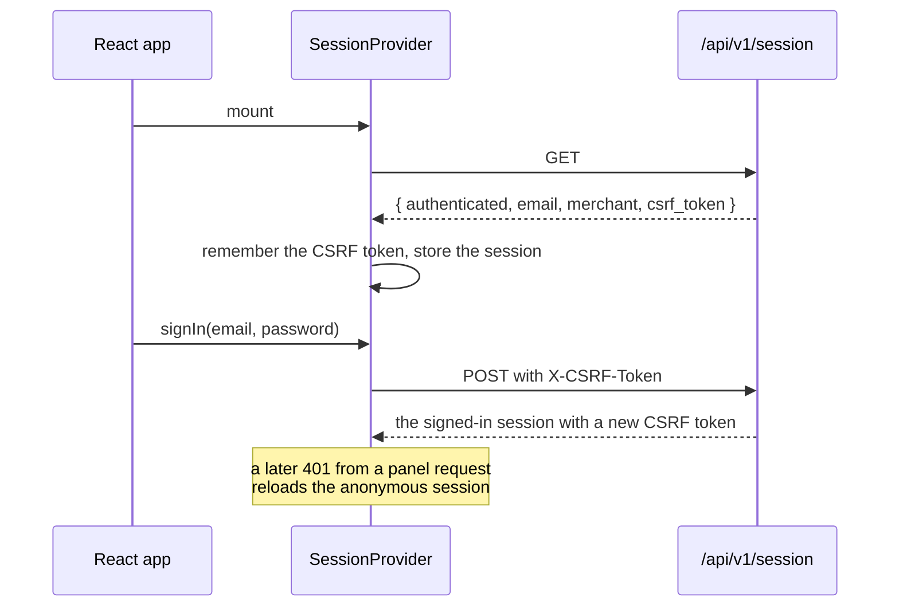

# Frontend

The merchant panel is a React 19 single-page app written in TypeScript and built with Vite.
It talks to the backend only through the JSON API, with request and response types generated
from the OpenAPI contract, so a contract change that the panel does not handle fails the
build instead of a screen. It authenticates with the browser session, not tokens.

## Structure

| Path | Contents |
|---|---|
| [`src/main.tsx`](../../frontend/src/main.tsx) | Mounts the app inside the router and the session provider |
| [`src/AppRoutes.tsx`](../../frontend/src/AppRoutes.tsx) | Public routes (`/login`, `/register`, `/confirm`) and the panel routes behind `RequireMerchant` |
| [`src/api/`](../../frontend/src/api) | The typed API client, the generated `schema.ts`, and the helper that turns problem details into messages |
| [`src/session/`](../../frontend/src/session) | The session context, its provider, and the route guard |
| [`src/auth/`](../../frontend/src/auth) | Sign-in, registration, and email confirmation pages |
| [`src/panel/`](../../frontend/src/panel) | The panel layout and the orders, products, product editing, and reports pages |
| [`src/ui/`](../../frontend/src/ui) | A small design system: `Page`, `Button`, `TextField`, `Alert`, `DataTable`, design tokens in `tokens.css`, and money formatting |
| [`e2e/`](../../frontend/e2e) | Playwright end-to-end tests |

## Talking to the API

[`src/api/client.ts`](../../frontend/src/api/client.ts) creates an
[openapi-fetch](https://openapi-ts.dev/openapi-fetch/) client typed by
[`schema.ts`](../../frontend/src/api/schema.ts), which `npm run api:types` generates from
[`openapi/`](../../openapi). `bin/ci` runs `npm run api:check`, which fails when the file is
out of date. Two middlewares wrap every request:

- the CSRF middleware adds the session's token in `X-CSRF-Token` to every request that is not
  `GET`, `HEAD`, or `OPTIONS`;
- the session expiry middleware reports a 401 answer from anything but the session resource
  itself, which the session provider uses to reload the anonymous session.

Requests stay on the page's own origin with `credentials: 'same-origin'`, so the HttpOnly
session cookie travels with them and no token is ever stored in JavaScript-readable storage.

## Session handling

[`SessionProvider`](../../frontend/src/session/SessionProvider.tsx) loads the session once,
exposes `signIn` and `signOut`, and replaces the CSRF token whenever the server issues a new
one, which it does on sign-in. [`RequireMerchant`](../../frontend/src/session/RequireMerchant.tsx)
guards the panel routes: anonymous visitors go to `/login`, and a signed-in account without
merchant access sees an explanation and a sign-out button instead of the panel.

## Pages and patterns

- Lists use cursor pagination through
  [`useCursorPages`](../../frontend/src/panel/useCursorPages.ts), which loads the first page
  and appends the next ones on request.
- The product editor sends the `ETag` it read in `If-Match`. When someone else changed the
  product in between, the API answers 412 and the page shows "The product changed since you
  loaded it; reload it and try again." instead of overwriting their edit.
- Money comes from the API as minor units in strings and is formatted and parsed in
  [`src/ui/money.ts`](../../frontend/src/ui/money.ts) without floating-point arithmetic.
- Styles are CSS modules with design tokens, so the strict Content-Security-Policy, which
  allows no inline styles or scripts, holds in production.

## Testing

- Unit and component tests run in Vitest with Testing Library in jsdom.
  [`renderApp`](../../frontend/src/test/render.tsx) renders the whole app at a path, and
  [MSW](https://mswjs.io) fakes the API at the network boundary, failing any test that makes
  a request without a handler.
- Playwright tests in [`e2e/`](../../frontend/e2e) drive a real browser against the test stack
  with the real backend, worker, and Mailpit: registration with email confirmation, the
  panel journey with the shared demo account, and the legacy URL redirect.
- ESLint with type-checked rules, Prettier, and `tsc` run in `bin/ci`.

## Development

Caddy serves the panel on `http://localhost:8080`, sending `/api/` and `/legacy/` to PHP-FPM
and everything else to the Vite development server, which reloads the page on every change.
The test stack and production serve the built app instead.

## Limitations

- Only the merchant panel exists; customers have no storefront and use the API directly.
- Pages handle loading and errors individually; there is no shared data-fetching cache.
- The end-to-end tests cover the main journeys only; most behavior is tested at the
  component level with a faked API.
