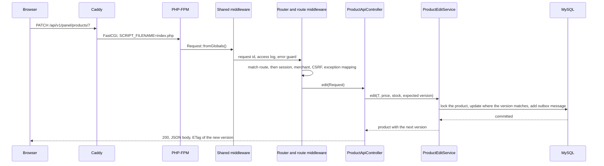

# Request lifecycle

This page follows one request through every layer: a merchant saves a new price and stock
for product 7 in the panel. The request is `PATCH /api/v1/panel/products/7` with a JSON
body, the session cookie, the CSRF token in `X-CSRF-Token`, and the product version the
merchant loaded in `If-Match`. Other requests take the same path and differ only in the
middleware their route needs.

## 1. Caddy

Caddy terminates HTTPS and handles the request according to
[`docker/caddy/backend.caddy`](../../docker/caddy/backend.caddy): every path under `/api/`
and `/legacy/` is rewritten to `/index.php` and sent to PHP-FPM over FastCGI, while PHP still
sees the original `REQUEST_URI`; a body over 1 MB gets 413 before PHP reads it. Every other
path serves the React app's files. On the way
back, [`headers.caddy`](../../docker/caddy/headers.caddy) adds the Content-Security-Policy and
the other security headers and removes headers that reveal software versions.

## 2. PHP-FPM and the front controller

A PHP-FPM worker runs [`backend/public/index.php`](../../backend/public/index.php), which
builds the container through `ContainerFactory::create()` and calls
`HttpApplication::run(Request::fromGlobals())`. The service definitions come from a cached
file that OPcache keeps in memory, so this costs no reflection. `Request::fromGlobals()`
reads the method, path, query, headers, body, and client address once; the rest of the code
works with this immutable object instead of superglobals.

## 3. Middleware every request passes

[`HttpApplication`](../../backend/src/Shared/Http/HttpApplication.php) registers the
controllers, which are built only when one of their routes matches, and runs the request
through:

1. [`RequestIdMiddleware`](../../backend/src/Shared/Http/Middleware/RequestIdMiddleware.php):
   takes a well-formed `X-Request-Id` or generates a UUID, adds it to every log record, and
   returns it in the response.
2. [`AccessLogMiddleware`](../../backend/src/Shared/Http/Middleware/AccessLogMiddleware.php):
   logs the method, path, status, and duration when the request ends, whatever the outcome.
3. [`UnhandledErrorMiddleware`](../../backend/src/Shared/Http/Middleware/UnhandledErrorMiddleware.php):
   catches anything unexpected, logs it with its stack trace, and answers 500 without
   revealing internals.

## 4. Routing

The [`Router`](../../backend/src/Shared/Http/Router.php) matches the method and path against
the registered routes; `{id:\d+}` makes `7` the route parameter `id`. A path that exists for
other methods answers 405 with an `Allow` header, and an unknown path 404.

## 5. Route middleware

The matched route runs the middleware its attributes ask for, in this order:

| Step | Middleware | For this request |
|---|---|---|
| 1 | [`ErrorMiddleware`](../../backend/src/Shared/Http/Middleware/ErrorMiddleware.php) | Turns malformed input, such as invalid JSON, into 400, and a missing `If-Match` into 428 |
| 2 | [`RateLimitMiddleware`](../../backend/src/Shared/Http/Middleware/RateLimitMiddleware.php) | Not used: the route has no `#[RateLimit]`. Where present, it runs before anything costly |
| 3 | [`SessionMiddleware`](../../backend/src/Shared/Http/Middleware/SessionMiddleware.php) | Starts the session, stored in Redis, from the cookie |
| 4 | [`MerchantMiddleware`](../../backend/src/Shared/Http/Middleware/MerchantMiddleware.php) | `#[RequireMerchant]`: 401 for anonymous visitors, 403 for accounts without merchant access, which it reads from the database |
| 5 | [`CsrfMiddleware`](../../backend/src/Shared/Http/Middleware/CsrfMiddleware.php) | 403 unless `X-CSRF-Token` matches the session's token |
| 6 | [`ApiKeyMiddleware`](../../backend/src/Shared/Http/Middleware/ApiKeyMiddleware.php) | Not used: only the reports API needs an API key |
| 7 | [`ExceptionMappingMiddleware`](../../backend/src/Shared/Http/Middleware/ExceptionMappingMiddleware.php) | Maps the domain exceptions the route declares with `#[MapException]` to problem details |

The merchant check comes before the CSRF check, so an anonymous visitor learns they must sign
in rather than that their token is wrong.

## 6. Controller

[`ProductApiController::edit()`](../../backend/src/Catalog/Controller/ProductApiController.php)
does three things only: parse the request, call one application service, and respond.
[`EditProductRequest::fromRequest()`](../../backend/src/Catalog/Request/EditProductRequest.php)
reads the version from `If-Match`, the price and stock from the body, and the id from the
route, and rejects invalid values.

## 7. Application service and database

[`ProductEditService::edit()`](../../backend/src/Catalog/Service/ProductEditService.php)
runs one READ COMMITTED transaction:

1. lock the product row with `SELECT … FOR UPDATE`;
2. compare its version with the one from `If-Match`, throwing
   `ProductVersionMismatchException` when they differ;
3. update the row on the condition that the version is still the expected one, increasing it;
4. add a `ProductStockChangedMessage` to the outbox in the same transaction.

When the transaction commits, the change and the message are stored together. The outbox
relay later publishes the message, and the worker removes the product from the Redis cache,
so the public catalog shows the new price.

## 8. Response

The controller answers through the
[`Responder`](../../backend/src/Shared/Http/Responder.php) with the product as JSON and an
`ETag` holding the new version, which the panel keeps for its next save. Back in the shared
middleware, the access log records the status and duration with the request id, and Caddy
adds its headers and compresses the body.

### When something goes wrong

| Situation | Where it stops | Answer |
|---|---|---|
| Not signed in | `MerchantMiddleware` | 401 problem details |
| Signed in without merchant access | `MerchantMiddleware` | 403 |
| Missing or wrong CSRF token | `CsrfMiddleware` | 403 |
| No `If-Match` header | `EditProductRequest` | 428 |
| Someone saved first | `ProductEditService` | 412 "The product changed since you loaded it; reload it and try again." |
| Unknown product | `ProductEditService` | 404 |
| Stock below what open orders reserve | the `Product` entity | 422 |
| Anything unexpected | `UnhandledErrorMiddleware` | 500 with the request id to quote; details only in the log |

## Limitations

- PHP builds the container and the router for every request; the service definitions are
  cached, but the route table is compiled again each time.
