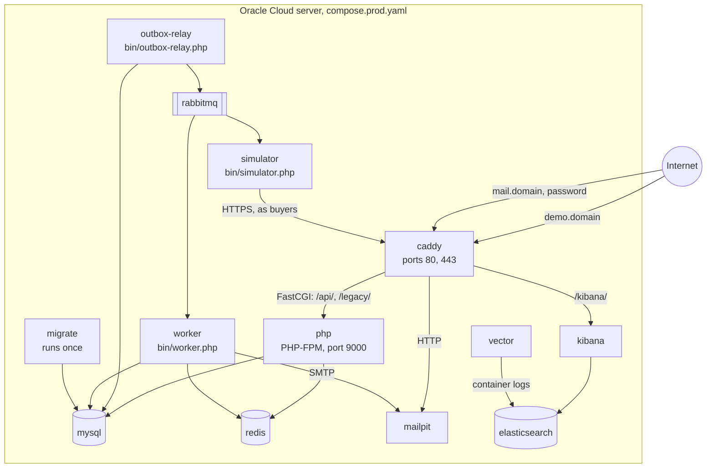

# System

The system runs as a set of Docker containers described by Compose: one web entry point
(Caddy), the PHP API, two long-running PHP processes for background work, and the services
they rely on. The same images and configuration serve development, the test stack that
`bin/ci` uses, and production, so a change is tested on the setup that runs it.

## Containers in production

| Container | Image | Role |
|---|---|---|
| `caddy` | built from [`docker/caddy/Dockerfile`](../../docker/caddy/Dockerfile) | The only container with published ports. Obtains HTTPS certificates, adds security headers, serves the built React app, and sends `/api/` and `/legacy/` to PHP-FPM over FastCGI. Mailpit is served on its own domain behind a password. |
| `php` | `prod` stage of [`docker/php/Dockerfile`](../../docker/php/Dockerfile) | PHP-FPM running the JSON API through the front controller [`backend/public/index.php`](../../backend/public/index.php). |
| `worker` | same PHP image | Consumes RabbitMQ messages: sends emails, expires unpaid orders, invalidates cached products, and recomputes the daily sales summary after a payment. Runs as `www-data`. |
| `outbox-relay` | same PHP image | Publishes messages stored in the outbox table to RabbitMQ. Runs as `www-data`. |
| `migrate` | same PHP image | Applies Phinx migrations and exits; the PHP services start only after it succeeded. |
| `seed-demo` | same PHP image | Adds the demo catalog; run by `bin/deploy`, not by `up` (profile `tools`). |
| `kibana-setup` | `curlimages/curl` | Creates the log index settings, the data view, and the dashboards; run by `bin/deploy` (profile `tools`). |
| `mysql` | `mysql:8.4` | Orders, products, users, payments, the outbox, and the daily sales summary. |
| `redis` | `redis:7.4-alpine` | Product cache, rate-limit counters, and the state of Black Friday simulations (database 0), and sessions (database 2). |
| `rabbitmq` | `rabbitmq:4-management` | Queues `emails`, `orders`, `catalog`, `simulation`, and `failed_messages`. |
| `mailpit` | `axllent/mailpit` | Catches outgoing email, so visitors of the demo can read their confirmation messages. |
| `simulator` | same PHP image | Consumes only the `simulation` queue and runs [Black Friday simulations](../flows/black-friday.md): its buyers shop through Caddy like customers. Runs as `www-data`. |
| `elasticsearch`, `kibana`, `vector` | Elastic 9.2 and Vector images | [Log search](../operations/observability.md#on-the-server): Vector ships the containers' logs, Elasticsearch keeps a week of them, and Kibana shows them under `/kibana/` on the mail domain. |

Everything except Caddy is reachable only on the Compose network. Data lives in named
volumes (`mysql_data`, `rabbitmq_data`, `redis_data`, and Caddy's certificates), which
survive redeployments; [`compose.prod.yaml`](../../compose.prod.yaml) explains why its
project keeps the repository's earlier name.

## How the containers communicate

| From | To | How | Why |
|---|---|---|---|
| Browser | Caddy | HTTPS | The panel and the API share one origin, so the session cookie and CSRF protection work without CORS. |
| Caddy | PHP-FPM | FastCGI, always to `index.php` | PHP-FPM speaks FastCGI natively, so there is no second web server inside the PHP container. |
| PHP | MySQL | PDO with native prepared statements | Every query is parameterized. |
| PHP, worker | Redis | phpredis with short timeouts | When Redis is unreachable, the cache and the rate limiter step aside instead of failing requests. |
| Relay | RabbitMQ | AMQP through Symfony Messenger | The relay leases outbox rows, publishes them, then deletes them, so delivery is at least once. |
| RabbitMQ | Worker | AMQP | Failed messages are retried with growing delays, then parked in `failed_messages`. |
| Worker | Mailpit | SMTP | Production sends no real email; Mailpit shows what would have been sent. |
| Simulator | Caddy | HTTPS to the public name, resolved to the Caddy container | Simulated buyers take the same path as customers, through the proxy, PHP-FPM, and every middleware. |
| Vector | Docker, Elasticsearch | The Docker socket, read-only; HTTP | Collects every container's JSON logs without access to their files. |

## Development and test stacks

[`compose.yaml`](../../compose.yaml) runs the same backend services with the repository
mounted into the containers, plus:

- `frontend`: the Vite development server with hot reload, reached through Caddy on
  `http://localhost:8080`;
- a test stack in the `test` profile (`php-test-web`, `worker-test`, `outbox-relay-test`,
  `simulator-test`, `caddy-test` on port 8081, and `migrate-test`), which uses the `app_test` database, Redis
  databases 1 and 3, and separate queues, so tests never touch development data;
- one-off tool containers in the `tools` profile: `php-test` (PHPUnit and the static checks),
  `frontend-test` (the frontend toolchain), `e2e` (Playwright), and `k6`;
- the `observability` profile with Elasticsearch, Kibana, and Vector, which collects the
  containers' JSON logs; production runs them as regular services
  ([observability](../operations/observability.md#on-the-server)).

Development services publish their ports on `127.0.0.1` only, so their development
credentials are not reachable from the local network.

## Images

The PHP Dockerfile has three stages: `base` installs the extensions and the PHP-FPM pool
configuration ([`docker/php/fpm-pool.conf`](../../docker/php/fpm-pool.conf)), `dev` adds
Xdebug, and `prod` copies the backend with its runtime dependencies only and enables OPcache
without timestamp checks. The production Caddy image builds the React app in a Node stage and
copies the result.

## Limitations

- One server without redundancy; a server failure takes the demo down until it is restored.
- Images are built on the server during deployment rather than in CI, so there is no quick
  rollback to a previous image.
- When the Redis container is gone entirely, resolving its name in Docker's DNS can take
  several seconds per request, which the client timeouts do not shorten.
