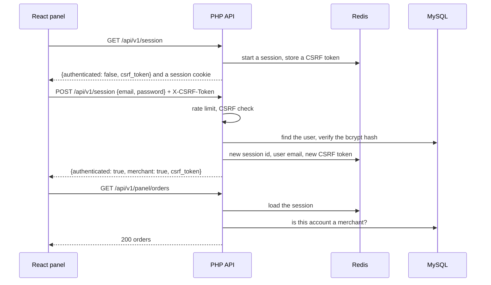

# Authentication and access

Merchants sign in with an email and a password. The server keeps the signed-in user in a
session stored in Redis and identified by an HttpOnly cookie; every state change also needs a
CSRF token that the API hands to the panel. Signing in is not enough to use the panel: the
account needs merchant access, which only an operator grants.



## The session

[`Session`](../../backend/src/Shared/Http/Session.php) starts PHP's session with strict mode
(unknown ids are rejected) and a cookie that is HttpOnly, `SameSite=Lax`, and `Secure` when
`SESSION_COOKIE_SECURE` is set, as it is in production. The PHP-FPM pool stores sessions in
Redis ([`fpm-pool.conf`](../../docker/php/fpm-pool.conf)), so deploying a new version does
not sign anyone out, and several PHP containers could share them.

Only routes that need the session start it. The public API for carts, orders, and payments
stays sessionless; routes opt in with `#[UsesSession]` or `#[RequireMerchant]`.

## CSRF protection

`GET /api/v1/session` returns the session's CSRF token. The panel's API client sends it in
the `X-CSRF-Token` header with every request that is not `GET`, `HEAD`, or `OPTIONS`, and
[`CsrfMiddleware`](../../backend/src/Shared/Http/Middleware/CsrfMiddleware.php) answers 403
when it is missing or wrong, comparing with `hash_equals`. A cross-site form cannot set a
custom header, and `SameSite=Lax` keeps the cookie off cross-site POST requests as well.

## Signing in

`POST /api/v1/session` ([`AuthApiController::signIn()`](../../backend/src/Auth/Controller/AuthApiController.php)):

1. The route's rate limit (`SIGN_IN_RATE_LIMIT`, 10 attempts per 5 minutes per client
   address in production) answers 429 with `Retry-After` before any password is checked.
2. [`UserAuthService::authenticate()`](../../backend/src/Auth/Service/UserAuthService.php)
   looks the user up and verifies the password. For an unknown address it verifies against a
   hash of an unknown password, so the response takes as long as for a wrong password and
   its timing does not reveal which accounts exist.
3. A wrong password or unknown address answers 401 with the same message; an unconfirmed
   address answers 403.
4. [`CurrentUser::signIn()`](../../backend/src/Auth/Infrastructure/Session/CurrentUser.php)
   regenerates the session id, which defeats session fixation, and stores the email.
5. The response carries a new CSRF token, so a token planted before sign-in is useless.

`DELETE /api/v1/session` removes the user from the session and regenerates its id.

## Merchant access

Registering and confirming an email address gives no access to the panel. An operator grants
it on the server:

```sh
php bin/grant-merchant.php person@example.com
```

[`GrantMerchantAccessService`](../../backend/src/Auth/Service/GrantMerchantAccessService.php)
sets `users.merchant_since` for a confirmed account. Panel routes carry `#[RequireMerchant]`,
and [`MerchantMiddleware`](../../backend/src/Shared/Http/Middleware/MerchantMiddleware.php)
answers 401 to anonymous visitors and 403 to accounts without access. It reads the role from
the database on every request, so granting or revoking access applies at once.
`GET /api/v1/session` reports `merchant`, and the panel shows a signed-in account without
access how to get it.

[`bin/create-merchant.php`](../../backend/bin/create-merchant.php) creates a confirmed
merchant in one step; deployment uses it for the shared demo account.

## When the session expires

When a panel request answers 401, the React client reloads the anonymous session with its new
CSRF token, and the route guard sends the merchant to the sign-in page, instead of showing
errors on a page that still looks signed in.

## Integrations

The reports API under `/api/v1/reports/` does not use sessions: integrations send a secret in
`X-Api-Key`, which [`ApiKeyMiddleware`](../../backend/src/Shared/Http/Middleware/ApiKeyMiddleware.php)
compares with `hash_equals` against `REPORTS_API_KEY`.

## Tests

- [`AuthApiTest`](../../backend/tests/Functional/Auth/AuthApiTest.php),
  [`PanelApiTest`](../../backend/tests/Functional/Order/PanelApiTest.php), and
  [`SessionStorageTest`](../../backend/tests/Functional/Http/SessionStorageTest.php), through
  the web server: sign-in and sign-out, CSRF rejection, token rotation, wrong passwords,
  unconfirmed accounts, invalid registrations, merchant checks, and sessions stored in Redis.
- [`RouterTest`](../../backend/tests/Unit/Shared/Http/RouterTest.php): merchant checks, rate
  limits, and the order of the middleware.
- [`SessionProvider.test.tsx`](../../frontend/src/session/SessionProvider.test.tsx) and
  [`RequireMerchant.test.tsx`](../../frontend/src/session/RequireMerchant.test.tsx): the
  panel's side, including an expired session and one that cannot be loaded.

## Limitations

- Merchant access is all or nothing; there are no finer roles such as read-only.
- Rate limits count per client address in fixed windows, so visitors behind one shared
  address share a limit.
- Passwords cannot be reset or changed yet.
