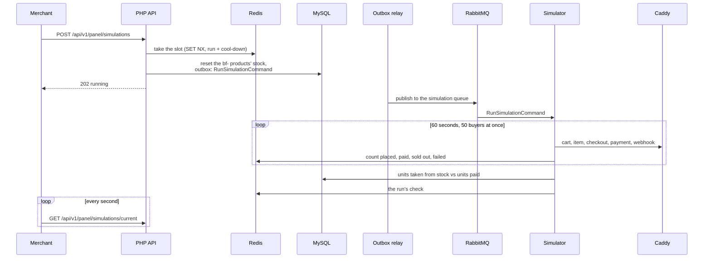

# Black Friday simulation

A merchant presses **Start Black Friday** in the panel, and for a minute simulated buyers shop
through the public API: they create carts, check out, pay with FakePay, and receive its signed
webhooks, until the shelves are empty and further checkouts are refused. The page follows the
run live, and at the end compares the stock that left the shelves with the orders that were
paid ([0025](../decisions/0025-black-friday-through-the-public-api.md)).

## Starting

[`StartSimulationHandler`](../../backend/src/Simulation/Command/StartSimulationHandler.php)
runs synchronously, through the command bus, and does three things:
1. It takes the one slot for a simulation in Redis with `SET NX` and an expiry covering the run
   and a cool-down. While another simulation holds it, the panel gets 409 with the seconds to
   wait. The demo account is public, so this bounds the load anyone can cause.
2. It resets the stock of five products with SKUs `bf-1` to `bf-5`, keeping what open orders
   still reserve.
3. In the same transaction, it records `RunSimulationCommand` in the outbox, routed to the
   `simulation` queue.

## Running

The `simulator` container runs [`bin/simulator.php`](../../backend/bin/simulator.php), a
Messenger worker that consumes only the `simulation` queue, so the load never delays the
worker's emails or expiries.
[`HttpLoadGenerator`](../../backend/src/Simulation/Infrastructure/HttpLoadGenerator.php)
drives the buyers on one Symfony HTTP client, which sends their requests concurrently. Each
buyer:
1. creates a cart and adds one of the products;
2. checks out with an idempotency key `simulation:<id>:<buyer>-<order>`;
3. starts a FakePay payment and sends the webhook FakePay would send, signed with its secret.

When an order ends (paid, refused because the stock ran out, or failed), the buyer starts the
next one, until the run's time is up.

The requests carry the `X-Load-Test-Key` header, which skips the rate limits and lets checkout
accept the reserved `simulation:` key prefix, and nothing else; otherwise one address would be
refused after twenty checkouts an hour. `bin/deploy` draws a new
random key on every deployment and gives it only to PHP and the simulator, and production
refuses to start without one rather than use the development key.
[`LoadTestKey`](../../backend/src/Shared/Http/LoadTestKey.php) accepts it only from private or
reserved addresses, such as the Docker network the simulator calls from; Caddy passes the real
client address, so a key leaked to someone on the internet still lifts nothing. Caddy's access
log redacts the header like the other credentials.

## The check

[`RunSimulationHandler`](../../backend/src/Simulation/Command/RunSimulationHandler.php)
compares the units taken from the products' stock with the units in the simulation's paid
orders. They match when the [stock reservation](checkout.md#checkout) neither sold a unit
twice nor lost one, however many buyers checked out at once. The check is saved even when the
run fails, so a run never stays "running".

## Following it

[`BlackFridayPage`](../../frontend/src/panel/BlackFridayPage.tsx) asks for the current
simulation every second while it runs and shows the counters, orders per second, the stock
left, and the check. The **Black Friday** dashboard in [Kibana](../operations/observability.md#on-the-server)
shows the same minute from the logs: requests, p95 latency, server errors, and commands handled
and refused.

The simulation's orders count in the reports like any others until the next simulation
starts. Every run leaves over a thousand orders and as many carts of buyers who found the
shelves empty, and the demo account is public, so
[`StartSimulationHandler`](../../backend/src/Simulation/Command/StartSimulationHandler.php)
removes them first, in the transaction that resets the stock: the orders of past runs that no
longer wait for payment, their payments, and every cart of simulation products without an
order. Orders still waiting for payment hold reserved stock, so a later run removes them once
they expire. A `SimulationOrdersRemovedMessage` through the outbox then has the worker
recompute the days of the removed paid orders in the daily sales summary, so the reports never
count an order that no longer exists. A visitor's own open cart with Black Friday products is
removed too; those products exist only for the simulation. `bin/remove-sales-history.php`
removes the simulation's orders together with the generated history.

## Configuration

| Variable | Production | Tests |
|---|---|---|
| `SIMULATION_SECONDS` | 60 | 3 |
| `SIMULATION_COOLDOWN_SECONDS` | 300 | 1 |
| `SIMULATION_BUYERS` | 50 | 4 |
| `SIMULATION_PRODUCTS` | 5 | 5 |
| `SIMULATION_STOCK` | 400 units per product | 6 |

## Tests

- [`SimulationApiTest`](../../backend/tests/Functional/Simulation/SimulationApiTest.php):
  access control, and a whole run through the API, the simulator, and the database, including
  the refusal of a second start and a consistent check.
- [`HttpLoadGeneratorTest`](../../backend/tests/Functional/Simulation/HttpLoadGeneratorTest.php):
  the buyers against the test proxy in the test process, so their code counts in the coverage.
- Unit tests of the start, the check, and the load test key in the router.

## Limitations

- The buyers run on the same server as the shop, so they compete with it for the CPU; a real
  load test would come from outside.
- All buyers come from one address; the rate limits are skipped rather than tested.
