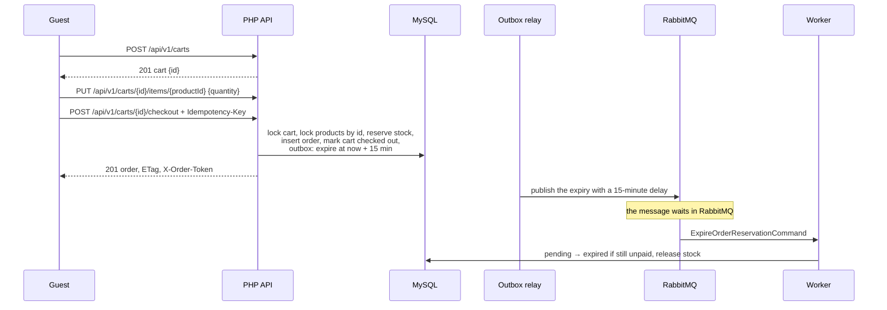
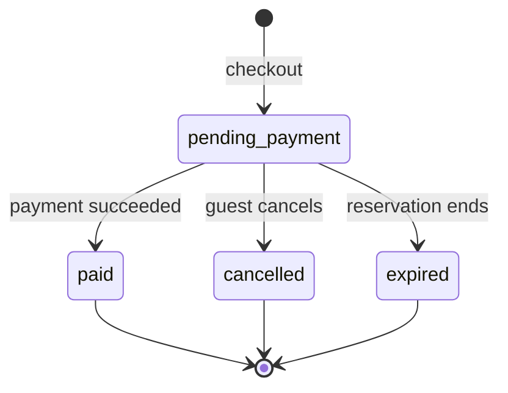

# Cart, checkout, and order expiry

A guest fills a cart and checks it out. Checkout reserves the stock, places an order with the
prices of that moment, and gives the guest an access token for the order. If the order is not
paid within the reservation time, it expires and the stock returns. Concurrent buyers never
oversell, and a retried checkout never places a second order.

## The cart

`POST /api/v1/carts` creates an open cart identified by a random UUID; it is rate-limited
per client address (`CART_CREATION_RATE_LIMIT`). `PUT /api/v1/carts/{id}/items/{productId}`
sets a product's quantity from 0 to 99, where 0 removes it.
[`CartService::setItemQuantity()`](../../backend/src/Cart/Service/CartService.php) checks that
the product exists, then locks the cart row and refuses changes to a cart that was already
checked out (409).

## Checkout

`POST /api/v1/carts/{id}/checkout` requires an `Idempotency-Key` header of 1 to 255
printable characters and has its own rate limit (`CHECKOUT_RATE_LIMIT`). Keys starting with
`history:` or `simulation:` are reserved for the shop's own orders and answer 400
([`ReservedOrderKeyPrefixEnum`](../../backend/src/Order/Enum/ReservedOrderKeyPrefixEnum.php)):
the shop removes those orders by their prefix, so a customer's order must never carry one.
Only the [Black Friday simulator](black-friday.md) may use `simulation:`.
[`PlaceOrderHandler`](../../backend/src/Order/Command/PlaceOrderHandler.php) runs one READ
COMMITTED transaction:

1. **Lock the cart row.** Concurrent checkouts of the same cart wait for each other.
2. **Recognize a retry.** If an order with this idempotency key exists, the same cart gets
   that order again; another cart with the same key gets 422. A unique index on the key backs
   this up.
3. **Check the cart.** It must be open (409) and not empty (422).
4. **Reserve stock.** [`StockReservation::reserve()`](../../backend/src/Catalog/Service/StockReservation.php)
   locks the products in ascending id order, so two checkouts with overlapping products wait
   for each other instead of deadlocking. Each reservation is a conditional update,
   `reserved = reserved + n WHERE stock - reserved >= n`, so stock can never be oversold even
   if a check were skipped. Missing stock answers 409.
5. **Place the order.** Order lines copy the product's SKU, name, and price, so later price
   changes do not touch placed orders. The reservation expires after
   `ORDER_RESERVATION_SECONDS` (900 in production).
6. **Close the cart and schedule work.** The cart is marked checked out. Two outbox messages
   are added: the reservation's expiry, due when it expires, and a stock change that removes
   the products from the cache.

The response is `201 Created` with the order, a `Location` header, an `ETag` of the order's
version, and the order access token in `X-Order-Token`. A retried checkout returns the same
order and the same token.

## The order access token

Guests have no accounts. [`OrderAccess`](../../backend/src/Order/Service/OrderAccess.php)
derives the token as an HMAC-SHA256 of the order id with `ORDER_ACCESS_SECRET`, so it needs
no storage and a retry can return it again. Reading the order (`GET /api/v1/orders/{id}`),
cancelling it, paying for it, and reading its payments all require it in `X-Order-Token`:
missing answers 400, wrong answers 404 like an unknown order. The order id alone, which the
panel and the logs show, opens nothing.

## Cancelling

`POST /api/v1/orders/{id}/cancel` needs the token and the order's `ETag` in `If-Match`.
[`CancelOrderHandler`](../../backend/src/Order/Command/CancelOrderHandler.php) compares the
version (412 when it changed, 428 when `If-Match` is missing), allows cancelling only an order
awaiting payment (409 otherwise), and changes the status with a conditional update, so of
several concurrent cancellations exactly one succeeds. The reserved stock is released in the
same transaction.

## Expiry

The relay publishes the expiry message with a delay until the reservation ends, so it waits
in RabbitMQ. The worker's
[`ExpireOrderReservationHandler`](../../backend/src/Order/Command/ExpireOrderReservationHandler.php)
then moves the order from pending payment to expired and releases its stock, through
[`OrderStatusChange`](../../backend/src/Order/Service/OrderStatusChange.php). The status
change is conditional on the current status and version, so if the order was paid or cancelled
in the meantime, nothing happens. A message delivered twice changes nothing the second time.

## Order statuses

Every change goes through `OrderStatusChange`, which applies the stock effect of the new
status: paid turns the reservation into sold stock, cancelled and expired release it.

## Tests

- [`PlaceOrderHandlerTest`](../../backend/tests/Unit/Order/Command/PlaceOrderHandlerTest.php)
  and [`CancelOrderHandlerTest`](../../backend/tests/Unit/Order/Command/CancelOrderHandlerTest.php):
  the rules with test doubles.
- [`CheckoutApiTest`](../../backend/tests/Functional/Order/CheckoutApiTest.php): idempotent
  retries, many concurrent buyers of the last item (exactly one succeeds), and concurrent
  checkouts of overlapping products without deadlocks.
- [`OrderCancellationApiTest`](../../backend/tests/Functional/Order/OrderCancellationApiTest.php)
  and [`OrderExpiryTest`](../../backend/tests/Functional/Order/OrderExpiryTest.php):
  optimistic locking, the access token, and expiry through the real broker and worker.
- [`bin/loadtest`](../../bin/loadtest): thousands of checkouts with less stock than demand,
  then a check in MySQL that nothing was oversold and every unpaid reservation was released.

## Limitations

- A client could still reserve a large share of the stock for 15 minutes through many carts;
  the rate limits per address slow this down but do not prevent it from many addresses.
- One currency per order.
