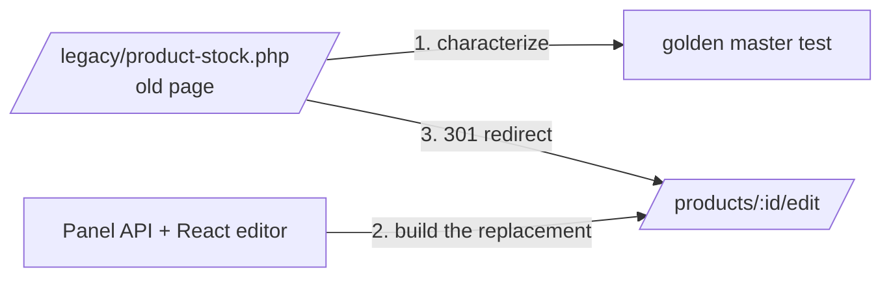

# Replacing legacy code

The project contains two legacy pages, imported as they might be found in an old codebase,
and shows two ways to deal with them safely: refactoring in place behind a golden master, and
replacing a page with the strangler fig pattern. Both start the same way: record what the old
code does before changing anything, so every later change is checked against it.

## The order report: refactoring in place

The old order report was imported unchanged in
[`bf7ad43`](https://github.com/skm1995/merchant-panel/commit/bf7ad43). It built SQL by
concatenating query parameters, echoed unescaped input and product names, read configuration
inline, and had no access control.

1. **Record a golden master.**
   [`OrderReportGoldenMasterTest`](../../backend/tests/Functional/Report/OrderReportGoldenMasterTest.php)
   requests the report through the web server for known data and compares the content with a
   stored [snapshot](../../backend/tests/Functional/Report/__snapshots__), replacing unstable
   values such as ids with placeholders.
2. **Write failing tests for the defects.**
   [`OrderReportSecurityTest`](../../backend/tests/Functional/Report/OrderReportSecurityTest.php)
   shows that SQL injection does not leak other orders, that stored product names and
   reflected parameters cannot inject scripts, and that the report needs the reports API key.
3. **Refactor.** The report moved into the `Report` feature:
   [`OrderReportController`](../../backend/src/Report/Controller/OrderReportController.php)
   at the old URL `/legacy/order-report.php`, validated parameters, a prepared query in the
   repository, and a template that escapes every value. The golden master kept passing, so
   the visible behavior stayed the same, while the security tests turned green.

The URL stayed the same because external links and bookmarks depend on it.

## The product stock page: the strangler fig pattern

The old product stock page let anyone change a product's price and stock through a form,
with SQL built from the request. Instead of fixing it in place, it was replaced by a new
feature and then retired.

1. **Characterize.** [`a5bfeb9`](https://github.com/skm1995/merchant-panel/commit/a5bfeb9)
   imported the page as found and recorded a golden master of what it shows and what it
   stores.
2. **Build the replacement on the current architecture.** The panel API for products
   (`GET` and `PATCH /api/v1/panel/products/{id}`) with merchant access, CSRF protection,
   optimistic locking, and cache invalidation through the outbox, plus the React
   [`ProductEditPage`](../../frontend/src/panel/ProductEditPage.tsx); see
   [Merchant panel](panel.md).
3. **Strangle the old page.** [`2c6fd4d`](https://github.com/skm1995/merchant-panel/commit/2c6fd4d)
   deleted it and turned its URL into
   [`LegacyProductStockController`](../../backend/src/Catalog/Controller/LegacyProductStockController.php),
   which answers `GET /legacy/product-stock.php?id=7` with a permanent redirect to
   `/products/7/edit`. It accepts only a positive integer id; anything else answers 404, and
   other methods 405.
4. **Replace the golden master** with
   [`LegacyProductStockUrlTest`](../../backend/tests/Functional/Catalog/LegacyProductStockUrlTest.php),
   which proves that old links still lead to the editor and that the inputs that reached the
   old SQL, an injected id or a write without signing in, change nothing.

## When to use which

| Approach | Fits when |
|---|---|
| Refactoring behind a golden master | The behavior is right and must stay; only the code is bad. |
| Strangler fig | The feature should work differently, or belongs in a new part of the system; the old entry point redirects until nobody uses it. |

[Coding patterns](../patterns.md#legacy-refactoring) lists both procedures as rules for
future legacy code.

## Limitations

- The order report is still a server-rendered HTML page, not part of the React panel.
