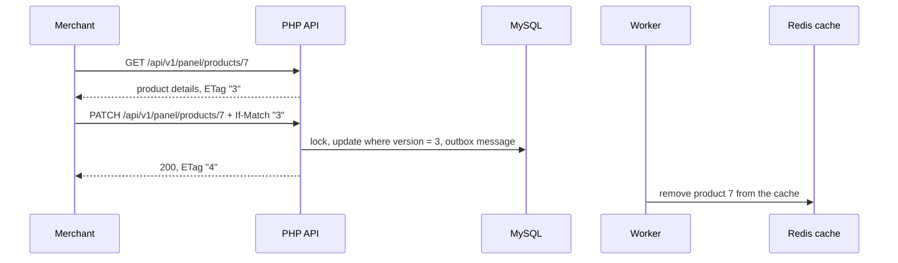

# Merchant panel and reports

Signed-in merchants use the panel to browse orders, edit products, and read revenue reports.
Every panel call goes to an API route under `/api/v1/panel/` that requires merchant access;
integrations read the same reports through an API key.

## Orders

The orders page calls `GET /api/v1/panel/orders`, which
[`ListOrdersHandler`](../../backend/src/Order/Query/ListOrdersHandler.php) answers from a read
model, newest first. It uses cursor pagination: each page returns `next_cursor`, the id of the
last order, and the next request continues after it. Unlike page numbers, a cursor never
skips or repeats orders when new ones arrive while the merchant scrolls. Pages hold 20 orders
by default and at most 100.

## Products

The products page lists the public catalog (`GET /api/v1/products`, also cursor paginated).
Editing a product uses its own panel routes:

[`ProductEditService`](../../backend/src/Catalog/Service/ProductEditService.php) changes
price and stock with optimistic locking. The `ETag` carries the product's version, the panel
sends it back in `If-Match`, and the update applies only to that version. When someone else
saved first, the merchant gets 412 with a message to reload, instead of silently overwriting
their change. Stock may not drop below what open orders have reserved (422); the
[`Product`](../../backend/src/Catalog/Entity/Product.php) entity enforces it, and the SQL
update repeats the condition. After the change commits, an outbox message makes the worker
remove the product from the Redis cache, so the public catalog shows the new values. The
cache's own expiry bounds how stale a value can get if a message is ever lost.
[Request lifecycle](../architecture/request-lifecycle.md) follows this request through every
layer.

## Reports

The Reports page asks for a period and shows its daily revenue, running total, and top
products; the Analytics page shows three reports on longer trends without asking. Every report
is a chart with its numbers in a table behind "Show data" and a sentence on how it is
computed. Plain SQL in
[`PdoReportReadRepository`](../../backend/src/Report/Repository/PdoReportReadRepository.php)
filters and adds up the orders, and
[`ReportService`](../../backend/src/Report/Service/ReportService.php) works on that small
result in PHP, with `Money` for amounts:

| Report | Route | How it is computed |
|---|---|---|
| Daily revenue | `GET /api/v1/panel/reports/daily-revenue` | SQL groups paid orders by day (`GROUP BY DATE(created_at)`) and sums their totals; PHP adds each day to a running total |
| Top products | `GET /api/v1/panel/reports/top-products` | SQL sums units and revenue per product from order lines, sorts by revenue, and cuts the list with `LIMIT` (at most 50); PHP numbers the positions. Equal revenue is ordered by product id |
| Stock outlook | `GET /api/v1/panel/reports/stock-outlook` | SQL sums the units each product sold in the last 28 full days from the [daily sales summary](../decisions/0017-daily-sales-summary-recomputed-per-day.md) and sorts by available stock per unit sold, with `LIMIT`; PHP turns that into units per day and whole days of stock left |
| Order heatmap | `GET /api/v1/panel/reports/order-heatmap` | SQL counts paid orders of the period per `WEEKDAY()` and `HOUR()` in UTC, reading only the `orders_status_created_at` index |
| Monthly revenue | `GET /api/v1/panel/reports/monthly-revenue` | SQL sums the summary's revenue per month for the last 24 months; PHP lays out the last 12 next to the same months a year earlier, with the change in percent, and fills months without sales with zero |

A period may cover at most 366 days, and amounts are summed in one currency (PLN by default).
[`ReportQueryPlanTest`](../../backend/tests/Functional/Report/ReportQueryPlanTest.php) runs
`EXPLAIN` on every report query and fails if it stops reading a range of its index: the
orders reports must range-scan `orders_status_created_at` (the heatmap without reading any
order row), and the summary reports a range of the summary's primary key, which starts with
the day. A change that would make a report read a whole table is caught in CI.

Integrations read the same reports at `/api/v1/reports/…` with the `X-Api-Key` header instead
of a session; one controller serves both, so the two cannot drift apart.

## Tests

- [`OrdersPage.test.tsx`](../../frontend/src/panel/OrdersPage.test.tsx),
  [`ProductEditPage.test.tsx`](../../frontend/src/panel/ProductEditPage.test.tsx), and
  [`ReportsPage.test.tsx`](../../frontend/src/panel/ReportsPage.test.tsx): the pages against a
  faked API.
- [`PanelApiTest`](../../backend/tests/Functional/Order/PanelApiTest.php),
  [`PanelProductApiTest`](../../backend/tests/Functional/Catalog/PanelProductApiTest.php), and
  [`ReportApiTest`](../../backend/tests/Functional/Report/ReportApiTest.php): the routes
  through the web server, including access control, stale versions, and cache invalidation.
- [`panel.spec.ts`](../../frontend/e2e/panel.spec.ts): signing in with the demo account and
  moving between the pages in a real browser.

## Limitations

- Merchants see all orders and products of the one shop; there is no per-merchant data.
- Reports cover one currency at a time and have no export.
