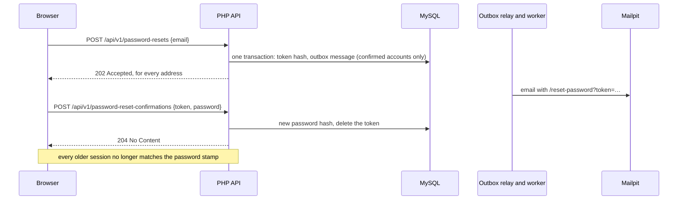

# Password reset

A merchant who forgot the password asks for a link by email and sets a new password with it.
Like registration, the request never reveals whether an address has an account, and the email
goes through the transactional outbox. Setting the new password ends every session of the
account, so whoever knew the old password is signed out.

## Asking for a link

[`ForgotPasswordPage`](../../frontend/src/auth/ForgotPasswordPage.tsx), linked from the
sign-in page, posts the address to `POST /api/v1/password-resets`. The route uses the session,
so it needs the CSRF token, and it has a rate limit per client address
(`PASSWORD_RESET_RATE_LIMIT`, 5 an hour in production).

[`RequestPasswordResetService`](../../backend/src/Auth/Service/RequestPasswordResetService.php)
normalizes and validates the address (422 when it is not one), then, in one transaction:

1. sends nothing for an unknown or unconfirmed address; the owner of an unconfirmed account
   repeats the registration to get the confirmation again;
2. sends nothing when the account's last link is less than five minutes old, so nobody can
   flood an inbox with links;
3. otherwise stores the SHA-256 hash of a random 32-byte token in `password_reset_tokens`,
   one row per account, which replaces an earlier link, with an expiry one hour ahead, and adds
   a [`PasswordResetEmailMessage`](../../backend/src/Auth/Message/PasswordResetEmailMessage.php)
   with the raw token to the outbox.

The answer is always `202 Accepted`, and the page says that a link is on its way if the
address belongs to a confirmed account.
[`SendPasswordResetEmailHandler`](../../backend/src/Auth/Infrastructure/Messenger/SendPasswordResetEmailHandler.php)
sends the link `APP_BASE_URL/reset-password?token=…`.

## Setting the new password

[`ResetPasswordPage`](../../frontend/src/auth/ResetPasswordPage.tsx) asks for the new password
and posts it with the token from the link to `POST /api/v1/password-reset-confirmations`.
[`ResetPasswordService`](../../backend/src/Auth/Service/ResetPasswordService.php) checks the
password against the registration's rules first, then, in one transaction, finds the account
of the unexpired token under a row lock, stores the new bcrypt hash, and deletes the token, so
a link works once. An invalid, expired, or used token answers 422, and the page offers to ask
for a new link; a refused password leaves the link usable.

## Ending the other sessions

[`CurrentUser`](../../backend/src/Auth/Infrastructure/Session/CurrentUser.php) stores two
things in the session at sign-in: the account's email and its password stamp, a SHA-256
fingerprint of the password hash ([`User::passwordStamp()`](../../backend/src/Auth/Entity/User.php)).
On every request it reads the account and treats the session as signed out when the stamps
differ. A new password has a new hash, so every session signed in before the reset, in any
browser, ends at its next request, without a list of sessions per account
([0027](../decisions/0027-password-stamp-ends-sessions.md)).

## Tests

- [`PasswordResetApiTest`](../../backend/tests/Functional/Auth/PasswordResetApiTest.php):
  the whole flow through the worker and Mailpit, the old session ending, the same answer for
  unknown and unconfirmed addresses, the five-minute spacing, expired and used links, password
  rules, and CSRF.
- [`RequestPasswordResetServiceTest`](../../backend/tests/Unit/Auth/Service/RequestPasswordResetServiceTest.php)
  and [`CurrentUserTest`](../../backend/tests/Unit/Auth/Infrastructure/Session/CurrentUserTest.php):
  the spacing at its boundary and the session ending when the password or the account changes.
- [`ForgotPasswordPage.test.tsx`](../../frontend/src/auth/ForgotPasswordPage.test.tsx),
  [`ResetPasswordPage.test.tsx`](../../frontend/src/auth/ResetPasswordPage.test.tsx), and the
  end-to-end [`password-reset.spec.ts`](../../frontend/e2e/password-reset.spec.ts): the pages,
  and the journey from a forgotten password to signing in with the new one.

## Limitations

- An account with a password reset link can still be taken over by whoever controls its
  mailbox; there is no second factor.
- Two requests for the same account at the same moment can both send a link; the rate limit
  bounds it.
