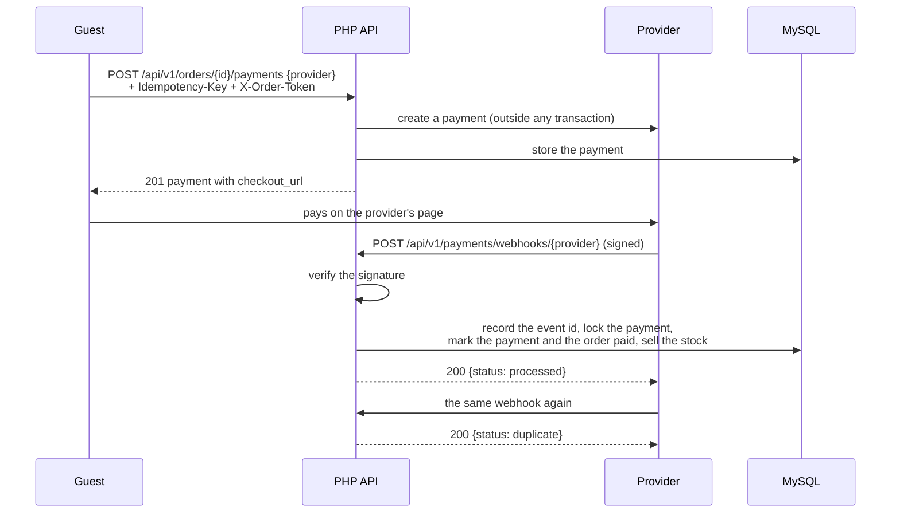

# Payments and webhooks

A guest pays for an order at an external payment provider. The API starts the payment and
returns the provider's checkout page; the provider later reports the result with a signed
webhook. Webhooks may arrive late, more than once, or at the same time, and each is applied
exactly once. The two providers, FakePay and QuickPay, are simulated, with different payload
and signature formats, to show how a gateway port keeps them out of the payment logic.

## Starting a payment

[`StartPaymentHandler`](../../backend/src/Payment/Command/StartPaymentHandler.php):

1. Verifies the order access token from `X-Order-Token`.
2. Returns the stored payment when the `Idempotency-Key` was used for this order before;
   the same key for another order answers 422.
3. Refuses an order that is not awaiting payment (409).
4. Asks the provider's gateway to create the payment. A provider call cannot join a database
   transaction, so it happens first, and the payment is stored afterwards. When two
   concurrent requests with the same key both reach the provider, the unique index on the key
   rejects the second insert, and that request returns the stored payment.

The gateways implement [`PaymentGatewayInterface`](../../backend/src/Payment/Gateway/PaymentGatewayInterface.php)
in [`Payment/Infrastructure/Gateway`](../../backend/src/Payment/Infrastructure/Gateway), and
[`PaymentGatewayFactory`](../../backend/src/Payment/Infrastructure/Gateway/PaymentGatewayFactory.php)
picks one by name. The amount is always the order's total, never a value from the client.

## Receiving a webhook

`POST /api/v1/payments/webhooks/{provider}` is sessionless; the signature is its
authentication. [`HandlePaymentWebhookHandler`](../../backend/src/Payment/Command/HandlePaymentWebhookHandler.php):

1. **Verifies the signature before anything else**, outside the transaction:

   | Provider | Header | Signed content |
   |---|---|---|
   | FakePay | `X-Fakepay-Signature` | HMAC-SHA256 of the raw body |
   | QuickPay | `X-Quickpay-Signature: t=…,v1=…` | HMAC-SHA256 of `timestamp.body`; a timestamp more than 5 minutes off is refused, so a captured webhook cannot be replayed later |

   Both compare with `hash_equals`. A bad signature answers 401, a malformed payload 400.
2. **Records the event id in an inbox table** with a unique key on provider and event id.
   A repeated delivery stops here and answers `{"status": "duplicate"}`.
3. **Locks the payment row**, so concurrent deliveries for the same payment are serialized,
   and ignores events for a payment that is already settled.
4. **Checks the amount and currency** against the payment, answering 422 on a mismatch.
5. **Applies the outcome:** a failed payment is marked failed; a successful one asks
   [`OrderSettlement`](../../backend/src/Order/Service/OrderSettlement.php) to mark the order
   paid, which turns its reserved stock into sold stock and adds an `OrderPaidMessage` to the
   outbox; the worker then recomputes that day in the daily sales summary. If the order was
   cancelled or expired in the meantime, the payment is marked `refund_required` instead, so
   money taken for an order that no longer exists is not lost from sight.

All of steps 2 to 5 run in one transaction, so an error leaves no trace and the provider's
retry can succeed.

## Reading a payment

`GET /api/v1/payments/{id}` needs the access token of the payment's order; a wrong token
answers 404 like an unknown payment.

## Tests

- [`StartPaymentHandlerTest`](../../backend/tests/Unit/Payment/Command/StartPaymentHandlerTest.php)
  and the gateway tests in [`tests/Unit/Payment`](../../backend/tests/Unit/Payment):
  idempotency, the access token, signatures, and payload parsing.
- [`PaymentApiTest`](../../backend/tests/Functional/Payment/PaymentApiTest.php): a webhook
  applied once when repeated and when delivered five times concurrently, forged and
  mismatched webhooks that change nothing, and a refund for a cancelled order.
- The k6 scenario in [`loadtest/black-friday.js`](../../loadtest/black-friday.js) delivers
  every webhook twice under load.

## Limitations

- Both providers are simulated; there is no real payment, refund, or reconciliation.
- A `refund_required` payment only records that a refund is due; nothing carries it out.
