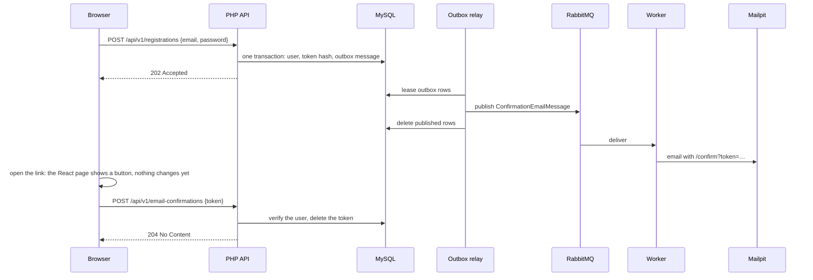

# Registration and email confirmation

A person registers with an email address and a password, receives a confirmation link by
email, and confirms the address by opening the link and pressing a button. Registration
never reveals whether an address already has an account, and the email is sent through the
transactional outbox, so a broker outage can delay it but never lose it.

## Registering

The panel's [`RegisterPage`](../../frontend/src/auth/RegisterPage.tsx) posts the form to
`POST /api/v1/registrations`. The route uses the session, so it needs the CSRF token, and it
has a rate limit per client address (`REGISTRATION_RATE_LIMIT`).

[`RegisterUserService`](../../backend/src/Auth/Service/RegisterUserService.php) runs one
transaction:

1. [`UserAuthService::register()`](../../backend/src/Auth/Service/UserAuthService.php)
   normalizes the email (trimmed, lowercase), validates it, and checks the password: at least
   8 characters, at most 72 bytes, and no NUL characters, because bcrypt hashes no more and
   cannot hash NUL. It stores the user with a bcrypt hash.
2. A random 32-byte [`ConfirmationToken`](../../backend/src/Auth/Service/ConfirmationToken.php)
   is generated. Only its SHA-256 hash is stored, with an expiry 24 hours ahead, so the
   database alone cannot confirm an address.
3. A [`ConfirmationEmailMessage`](../../backend/src/Auth/Message/ConfirmationEmailMessage.php)
   with the raw token goes into the outbox. The outbox row is deleted once it is published.

The response is always `202 Accepted`.

### When the address already has an account

| Situation | What happens | Response |
|---|---|---|
| The account is unconfirmed and the password matches | The confirmation is sent again with a new token, at most 5 times in 24 hours | 202, or 429 when the resend limit is reached |
| Any other existing account | The owner of the address receives an [`AccountExistsEmailMessage`](../../backend/src/Auth/Message/AccountExistsEmailMessage.php) suggesting to sign in | 202 |

So nobody can learn from the response which addresses have accounts, and the real owner
finds out about the attempt.

## Sending the email

[`OutboxRelay`](../../backend/src/Shared/Messaging/Outbox/OutboxRelay.php) leases a batch of
outbox rows with `SELECT … FOR UPDATE SKIP LOCKED`, publishes them to the `emails` transport,
and deletes them. A relay that dies after publishing and before deleting leaves the rows to be
published again when their 30-second lease expires, so delivery is at least once.

The worker's [`SendConfirmationEmailHandler`](../../backend/src/Auth/Infrastructure/Messenger/SendConfirmationEmailHandler.php)
builds the link from `APP_BASE_URL` and sends it with Symfony Mailer. The request id of the
registration request travels with the message, so its logs and the worker's logs share it.

## Confirming

The link opens [`ConfirmEmailPage`](../../frontend/src/auth/ConfirmEmailPage.tsx), which
changes nothing until the person presses "Confirm email". Mail scanners and link previews
open links automatically, and a GET request must never change state. The button posts the
token to `POST /api/v1/email-confirmations`.

[`ConfirmEmailService`](../../backend/src/Auth/Service/ConfirmEmailService.php) hashes the
token and, in one transaction, finds an unexpired token with that hash, marks the user
verified, and deletes the token. An unknown, expired, or already used token answers 422.

Confirming the address does not grant access to the merchant panel; see
[Authentication](authentication.md).

## Cleanup

Every night [`bin/purge-unconfirmed-accounts.php`](../../backend/bin/purge-unconfirmed-accounts.php)
deletes accounts left unconfirmed for a week, with their tokens, so abandoned and mistyped
registrations keep no personal data.

## Tests

- [`RegisterUserServiceTest`](../../backend/tests/Unit/Auth/Service/RegisterUserServiceTest.php)
  and [`UserAuthServiceTest`](../../backend/tests/Unit/Auth/Service/UserAuthServiceTest.php):
  validation, resending, the account-exists notice, and password limits.
- [`AsyncConfirmationFlowTest`](../../backend/tests/Functional/Auth/AsyncConfirmationFlowTest.php):
  the whole path through the web server, the outbox, RabbitMQ, the worker, and Mailpit,
  including that opening the link changes nothing and that a token works once.
- [`registration.spec.ts`](../../frontend/e2e/registration.spec.ts): the same journey in a
  real browser.

## Limitations

- Emails are plain text and go to Mailpit; the demo sends no real email.
- There is no password reset yet.
