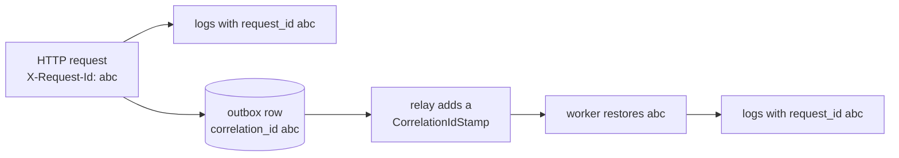

# Observability

Every process writes structured JSON logs, and a request id connects an HTTP request with all
the work it caused, including messages handled later by the worker. Locally, Elasticsearch and
Kibana make the logs searchable.

## Logs

Monolog, configured in [`LoggerFactory`](../../backend/src/Shared/Logging/LoggerFactory.php),
writes one JSON object per line to standard error, and Docker collects it. `LOG_LEVEL` sets
the threshold. Code logs through the injected PSR-3 `LoggerInterface` with a short constant
message and a context array, never by echoing.

| Message | Written by | Context |
|---|---|---|
| `Request handled` | [`AccessLogMiddleware`](../../backend/src/Shared/Http/Middleware/AccessLogMiddleware.php) | method, path, status, duration in milliseconds |
| `Unhandled exception` | [`UnhandledErrorMiddleware`](../../backend/src/Shared/Http/Middleware/UnhandledErrorMiddleware.php) | the exception with its stack trace |
| `Command handled` / `Command failed` | [`CommandLogMiddleware`](../../backend/src/Shared/Messaging/Bus/CommandLogMiddleware.php) | the command class, duration, and the exception when a handler refuses it |
| `Message handled` / `Message failed` | [`MessageLogMiddleware`](../../backend/src/Shared/Messaging/MessageLogMiddleware.php) | message type, transport, duration, and the exception on failure |
| `Cache unavailable; …`, `Rate limiting skipped …` | the cache and the rate limiter | the Redis error |

Request bodies, passwords, and tokens are never logged. Caddy writes its own JSON access log
as well, with cookies and the API key, order token, and CSRF headers replaced by `REDACTED`
([`access-log.caddy`](../../docker/caddy/access-log.caddy)).

## Following a request



[`RequestIdMiddleware`](../../backend/src/Shared/Http/Middleware/RequestIdMiddleware.php)
accepts a well-formed `X-Request-Id` from the client or generates a UUID, and returns it in
the response. [`CorrelationIdProcessor`](../../backend/src/Shared/Logging/CorrelationIdProcessor.php)
adds it to every log record as `extra.request_id`. The outbox stores it with each message,
the relay sends it as a `CorrelationIdStamp`, and the worker's
[`CorrelationIdMiddleware`](../../backend/src/Shared/Messaging/CorrelationIdMiddleware.php)
restores it, so the confirmation email sent a second later carries the id of the registration
request. A 500 response asks the user to quote this id.

## Searching the logs locally

```sh
docker compose --profile observability up -d
```

Vector reads the containers' logs through the Docker API, decodes the application's JSON into
the `app` field, and sends everything to Elasticsearch. Kibana opens at
`http://localhost:5601` with an "Application logs" data view. Useful queries:

| Query | Shows |
|---|---|
| `app.extra.request_id : "<id>"` | everything one request caused, across containers |
| `app.context.status >= 500` | failed requests |
| `app.level_name : "ERROR"` | errors, with stack traces in `app.context.exception` |
| `app.message : "Message handled"` | worker activity with durations |

## On the server

The production stack has no Elasticsearch, to keep the free server's resources for the
application. Logs are read with Docker:

```sh
cd ~/app && sudo docker compose -f compose.prod.yaml logs --since 1h php worker | grep <request id>
```

## Limitations

- No metrics, dashboards, or alerts in production; nobody is notified when the demo is down
  or errors increase.
- Production logs live only in Docker's rotated files on the server.
