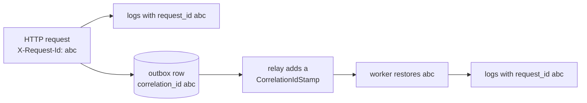

# Observability

Every process writes structured JSON logs, and a request id connects an HTTP request with all
the work it caused, including messages handled later by the worker. Locally, Elasticsearch and
Kibana make the logs searchable.

## Logs

Monolog, configured in [`LoggerFactory`](../../backend/src/Shared/Logging/LoggerFactory.php),
writes one JSON object per line to standard error, and Docker collects it. `LOG_LEVEL` sets
the threshold. Code logs through the injected PSR-3 `LoggerInterface` with a short constant
message and a context array, never by echoing.

| Message | Written by | Context |
|---|---|---|
| `Request handled` | [`AccessLogMiddleware`](../../backend/src/Shared/Http/Middleware/AccessLogMiddleware.php) | method, path, status, duration in milliseconds |
| `Unhandled exception` | [`UnhandledErrorMiddleware`](../../backend/src/Shared/Http/Middleware/UnhandledErrorMiddleware.php) | the exception with its stack trace |
| `Command handled` / `Command failed` | [`CommandLogMiddleware`](../../backend/src/Shared/Messaging/Bus/CommandLogMiddleware.php) | the command class, duration, and the exception when a handler refuses it |
| `Message handled` / `Message failed` | [`MessageLogMiddleware`](../../backend/src/Shared/Messaging/MessageLogMiddleware.php) | message type, transport, duration, and the exception on failure |
| `Cache unavailable; …`, `Rate limiting skipped …` | the cache and the rate limiter | the Redis error |

Request bodies, passwords, and tokens are never logged. Caddy writes its own JSON access log
as well, with cookies and the API key, order token, CSRF, and load test key headers replaced by
`REDACTED`
([`access-log.caddy`](../../docker/caddy/access-log.caddy)).

## Following a request



[`RequestIdMiddleware`](../../backend/src/Shared/Http/Middleware/RequestIdMiddleware.php)
accepts a well-formed `X-Request-Id` from the client or generates a UUID, and returns it in
the response. [`CorrelationIdProcessor`](../../backend/src/Shared/Logging/CorrelationIdProcessor.php)
adds it to every log record as `extra.request_id`. The outbox stores it with each message,
the relay sends it as a `CorrelationIdStamp`, and the worker's
[`CorrelationIdMiddleware`](../../backend/src/Shared/Messaging/CorrelationIdMiddleware.php)
restores it, so the confirmation email sent a second later carries the id of the registration
request. A 500 response asks the user to quote this id.

## Searching the logs locally

```sh
docker compose --profile observability up -d
```

Vector reads the containers' logs through the Docker API, decodes the application's JSON into
the `app` field, and sends everything to Elasticsearch. Kibana opens at
`http://localhost:5601` with an "Application logs" data view. Useful queries:

| Query | Shows |
|---|---|
| `app.extra.request_id : "<id>"` | everything one request caused, across containers |
| `app.context.status >= 500` | failed requests |
| `app.level_name : "ERROR"` | errors, with stack traces in `app.context.exception` |
| `app.message : "Message handled"` | worker activity with durations |

## On the server

Production runs the same Vector, Elasticsearch, and Kibana
([0024](../decisions/0024-log-search-in-production.md)). Kibana is at
`https://mail.szymonkozlowski.is-a.dev/kibana/`, behind the same user and password as Mailpit.
[`docker/elk/setup.sh`](../../docker/elk/setup.sh) runs after every deploy, here and in the
`observability` profile alike, and prepares:

- daily `app-logs-*` indices without replicas on the single node, deleted after seven days by
  the lifecycle policy in [`ilm-policy.json`](../../docker/elk/ilm-policy.json);
- the "Application logs" data view;
- the **Black Friday** dashboard from [`dashboards.ndjson`](../../docker/elk/dashboards.ndjson):
  requests and p95 latency over time, server errors, and commands handled and refused per type,
  refreshed every five seconds, made to watch a [Black Friday simulation](../flows/black-friday.md). Its charts are Vega-Lite specifications, so they are plain text
  in the repository; to change one, edit it in Kibana, export it under Stack Management, Saved
  objects, and replace the file.

## Alerts

[`bin/monitor`](../../bin/monitor) checks the demo from the outside and fails when the panel
or the API does not answer, or when the logs of the last 20 minutes hold a record at the ERROR
level: an unhandled exception or a message the worker failed to handle. Refused commands, such
as checkouts of sold-out products, are warnings and do not count. It retries for up to five
minutes, so the restarts of a deployment do not alert, and reads the logs through Kibana with
the demo tools' password.

[`monitor.yaml`](../../.github/workflows/monitor.yaml) runs it every 15 minutes, and GitHub
emails a failed run ([0026](../decisions/0026-alerts-from-a-scheduled-github-workflow.md)).
The run's log lists the latest errors with their request ids; the
[runbook](runbooks.md#when-the-monitor-fails) says what to do next. Locally, the same script
checks the development stack with the `observability` profile:

```sh
APP_URL=http://localhost:8080 KIBANA_URL=http://localhost:5601 KIBANA_USER=demo KIBANA_PASSWORD=local bin/monitor
```

Docker's own rotated log files remain as a fallback:

```sh
cd ~/app && sudo docker compose -f compose.prod.yaml logs --since 1h php worker | grep <request id>
```

## Limitations

- Alerts arrive by email within about 15 minutes and only to the repository's owner; they
  cover availability and errors, not slow responses.
- Logs are kept for seven days, on the same server as the application.
