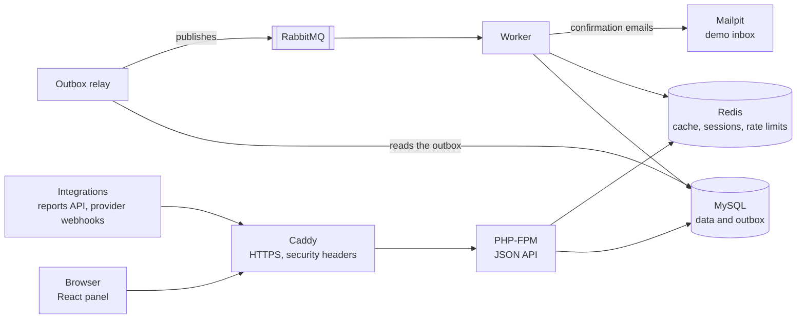

# Overview

Merchant Panel is a small online shop's backend and the panel its merchants use. Guests
browse a catalog, fill a cart, check out, and pay through a payment provider; merchants sign
in to a React panel to see orders, edit products, and read revenue reports. It is built
without a framework on purpose, so that the parts a framework usually hides, such as routing,
dependency injection, sessions, CSRF protection, and messaging, are visible and tested.

## What it does

| Area | Behavior | Main code |
|---|---|---|
| Catalog | Lists products with cursor pagination and reads single products through a Redis cache that resists stampedes. | [`backend/src/Catalog`](../backend/src/Catalog) |
| Cart | Guests create a cart and set item quantities without an account. | [`backend/src/Cart`](../backend/src/Cart) |
| Checkout | Turns a cart into an order: reserves stock under row locks, freezes prices, accepts retries through an `Idempotency-Key`, and schedules the reservation's expiry. | [`backend/src/Order`](../backend/src/Order) |
| Guest orders | Checkout returns an access token; reading, cancelling, and paying for the order need it. Cancelling uses optimistic locking through `If-Match`. | [`backend/src/Order`](../backend/src/Order) |
| Payments | Starts a payment at one of two simulated providers and applies their signed webhooks exactly once. | [`backend/src/Payment`](../backend/src/Payment) |
| Accounts | Registration with email confirmation, sign-in with a session cookie and CSRF token, and merchant access granted by an operator. | [`backend/src/Auth`](../backend/src/Auth) |
| Merchant panel | Orders, product editing with optimistic locking, and daily revenue and top product reports. | [`frontend/src`](../frontend/src) |
| Reports API | The same reports for integrations, authenticated with an API key. | [`backend/src/Report`](../backend/src/Report) |
| Sales history | Generates three years of orders (3 million by default) with seasonal peaks, so reports run on realistic volume, and removes them again in batches. A daily sales summary per product, refreshed by the worker after each payment, lets long-range reports read thousands of rows instead of millions. | [`backend/src/Analytics`](../backend/src/Analytics) |
| Legacy | A legacy page was characterized with golden-master tests and replaced; its old URL redirects to the panel. | [`backend/src/Catalog/Controller/LegacyProductStockController.php`](../backend/src/Catalog/Controller/LegacyProductStockController.php) |

The API is described in OpenAPI in [`openapi/`](../openapi/openapi.yaml), which is the
single source of truth: the backend's functional tests validate real responses against it,
and the frontend generates its TypeScript types from it.

## The parts

A request that must also cause work elsewhere, such as sending an email or expiring an unpaid
order later, stores a message in the outbox table in the same database transaction as its
data. The outbox relay publishes these messages to RabbitMQ, and the worker handles them. So
a broker outage never loses a message, and no message is sent for data that was rolled back.
[System](architecture/system.md) describes every container.

## Technology

| Layer | Technology |
|---|---|
| Backend | PHP 8.5 without a framework; Symfony Messenger, Mailer, and UID components; moneyphp; Monolog; Phinx migrations |
| Frontend | React 19, TypeScript 5.9, Vite, React Router, openapi-fetch with types generated by openapi-typescript |
| Data and messaging | MySQL 8.4, Redis 7.4, RabbitMQ 4 |
| Web | Caddy 2.10 in front of PHP-FPM |
| Quality | PHPUnit, PHPStan level 8, Deptrac, PHP CS Fixer, Vitest with Testing Library and MSW, ESLint, Prettier, Playwright, k6, gitleaks |
| Delivery | Docker Compose, GitHub Actions, an Oracle Cloud Always Free ARM server |
| Observability | JSON logs with request ids; Elasticsearch, Kibana, and Vector locally |

## Repository layout

| Path | Contents |
|---|---|
| [`backend/`](../backend) | PHP API: `src/` by feature, `tests/`, migrations, and the worker, relay, and maintenance commands in `bin/` |
| [`frontend/`](../frontend) | React panel, its unit tests, and the Playwright end-to-end tests in `e2e/` |
| [`openapi/`](../openapi) | API contract shared by both sides |
| [`docker/`](../docker), [`compose.yaml`](../compose.yaml), [`compose.prod.yaml`](../compose.prod.yaml) | Container configuration for development, tests, and production |
| [`bin/`](../bin) | `ci` runs every check, `deploy` deploys to the server, `loadtest` runs the k6 scenario |
| [`loadtest/`](../loadtest) | The "Black Friday" k6 scenario |
| [`docs/`](.) | This documentation |

## Limitations

- One shop, one currency, and simulated payment providers; there is no storefront for
  customers, only the API and the merchant panel.
- One production server without redundancy or a staging environment.
- Accounts cannot reset or change their password yet.
